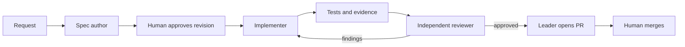

# Using the Codex workflow

The workflow combines versioned specifications, persistent handoff records,
independent agent review, and a PR. `AGENTS.md` is the short operating contract.
This page explains the handoffs.

1. Ask the leader to work on a named feature or to select a pending feature.
   It checks scope, isolates the branch, verifies the baseline, and reads memory.
2. For SDD work, the spec author commits requirements, design, and tasks. The
   leader integrates them and presents that revision. Review the files and
   explicitly approve them. Implementation waits for your answer.
3. The leader records approval and gives the implementer a fixed base commit,
   allowed paths, spec location, and expected evidence report. The implementer
   uses its own worktree. The leader inspects and integrates the commit.
4. A separate reviewer inspects the candidate commit in a separate worktree.
   It checks requirements against evidence and reports findings. After fixes,
   review the updated candidate again. Three failed cycles stop the loop.
5. The leader pushes and opens a PR only after approval and checks. It records
   the URL and reviewed commit, then closes the session memory. You merge.

For a documentation repair, record `sdd: false` and the scope. Skip spec approval
unless the user requests it. Still verify content and obtain independent review.
Do not silently exempt executable workflow or application behavior changes.

## What provides enforcement

Instructions tell agents how to work. They do not make violations impossible.
A deterministic local checker can reject malformed registry state and failed
tests. CI repeats that check on the server. Branch protection can require CI
and human approval before merge. Neither JSON approval records nor an agent
verdict authenticate a human identity.

The approved bootstrap provides local checks, CI, and role configuration.
A fully automatic orchestration service
and workflow telemetry exporters are separate features. Role prompts alone do
not schedule agents or stream events to Grafana.

## Reuse in another repository

Copy the workflow contract, role contracts, memory templates, and spec process.
Replace architecture, dependency commands, test commands, application endpoints,
and evidence requirements with that repository's facts. Do not copy RQ service
ports or declare historical code spec-approved. Start a new registry with honest
legacy status and add forward-looking features through the approval gate.
